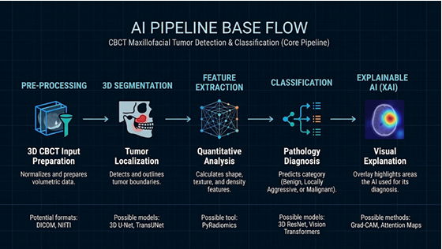

# Maxillo-facial Tumor Detection and Classification #

This project follows the implementation of an intelligent system meant to help doctors, oral and maxillofacial surgeons and radiologists in the automated detection, segmentation and classification of maxillo-facial tumors, using CBCT images and advanced artificial intelligence techniques.

## Desired pipeline ##
CBCT 3D images -> input preprocessing -> segmentation -> classification -> Predicted pathology class and visual explanations

## Current stage - Preprocessing and exploratory data analysis ##
The first stage implementation uses a restricted subset of 140 CBCT images from the DOLCHID Benchmark dataset, adnotated with binary tumor masks.  
The preprocessing pipeline applies a series of transformations on the images, using the MONAI library:  
- RAS (Right, Anterior, Superior) spacial reorientation  
- 1mm^3 spacial resampling
- patch extraction through cropping for memory optimization  

## Future implementations ##
Segmentation module using a Vision Transformer  
Classification module using a 3D Convolutional Neural Network  
Tumor features extraction  

### Dataset ###
[DOLCHID - Dental Odontogenic Lesion CBCT  and Histopathology Integrated Dataset](https://springernature.figshare.com/articles/dataset/Dental_Odontogenic_Lesion_CBCT_and_Histopathology_Integrated_Dataset_for_Benchmarking_Deep_Learning_Algorithms/30156622?file=58072198)